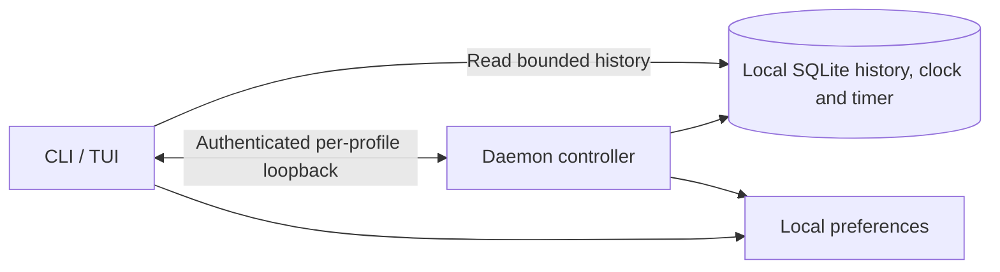

# Focusd

[](https://github.com/0xarchit/focusd/releases)
[](https://github.com/0xarchit/focusd/actions)
[](https://github.com/0xarchit/focusd/releases)  
[](LICENSE)
[](https://go.dev)


<p align="center">
  
</p>

<h3 align="center">Privacy-First Digital Wellbeing for Windows</h3>

<p align="center">
  <strong>Track your screen time. Own your data. No cloud required.</strong><br/>
  <a href="https://focusd.0xarchit.is-a.dev">focusd.0xarchit.is-a.dev</a>
</p>

---

## Overview

Focusd is a native Windows **screen time tracker** and **digital wellbeing** tool written in Go. A lightweight background daemon (`focusd_daemon.exe`) polls the foreground window via Win32 syscalls and records per-app and per-browser-tab usage into a local SQLite database. A separate CLI/TUI binary (`focusd.exe`) renders dashboards, manages limits, and controls the daemon over a local TCP IPC channel.

It functions as an **app usage monitor**, **browser time tracker**, **Pomodoro focus timer**, and **productivity dashboard** — a ~9 MB installer with a ~12 MB CLI binary and a ~8 MB daemon, no runtime dependencies. If you're looking for a **local, no-account alternative to RescueTime, StayFree, or Toggl Track**, focusd is built for that.

Nothing leaves your machine. The only network traffic is the optional update check against the GitHub Releases API.

| App | Distribution | Sync model | Account required |
|-----|-------------|-----------|-----------------|
| StayFree (Windows) | Microsoft Store (UWP) + Electron desktop | Cross-device sync | Yes |
| Toggl Track | Native C++/.NET desktop client ([source](https://github.com/toggl/toggldesktop)) | Cloud sync (Toggl account) | Yes |
| RescueTime | Native Windows client + web dashboard | Cloud sync (RescueTime account) | Yes |
| **Focusd** | **Standalone binary (~9 MB installer)** | **None — local SQLite only** | **No** |

Competitor distribution details come from each vendor's own product pages and repos. RAM figures were dropped from this table because they cannot be reproducibly sourced — measure on your own machine if you need them.

---

## Why focusd?

| Problem | How focusd solves it |
|---------|---------------------|
| Screen time trackers that send your data to the cloud | All data stays in a local SQLite database — no accounts, no telemetry |
| Trackers that ship a bundled browser or heavy runtime | Two small native Go binaries (~12 MB CLI, ~8 MB daemon); ~9 MB installer |
| No visibility into browser tab usage | Tracks time per tab via window title, grouped under 74 hard-coded categories |
| No way to limit distracting apps | Set daily per-app time limits with notifications |
| Hard to stay focused | Built-in Pomodoro timer with break reminders |

---

## Quick Start

**PowerShell** (recommended):


**Command Prompt**:
```cmd
curl -L -o focusd_setup.exe "https://github.com/0xarchit/focusd/releases/latest/download/focusd_setup.exe" && focusd_setup.exe
```

The NSIS installer (`installer.nsi`) installs both binaries to `%APPDATA%\focusd`, adds the install directory to your user `PATH`, registers `focusd_daemon.exe` under the `HKCU\...\Run` autostart key, registers an entry in **Add/Remove Programs**, and immediately launches the daemon.

Open a new terminal and type `focusd` to launch the TUI.

---

## Features

### Interactive TUI
Launching `focusd` with no arguments opens a Bubble Tea / Lipgloss terminal UI with five tabs: **Dashboard**, **Stats**, **Focus**, **Limits**, **Settings**. Mouse and alt-screen are enabled; minimum terminal size is 80×24. Press `?` for the full key-binding overlay.

### Background daemon
`focusd_daemon.exe` is built with the `-H=windowsgui` linker flag so it runs with no console window. It polls the active window every **5 seconds** (configurable 1–60s), batches sessions to SQLite every **5 minutes**, persists bounded active checkpoints on a throttled heartbeat (so a crash recovers cleanly), enforces retention every hour, and checks Pomodoro / break / app-limit conditions every 5 seconds.

### Per-app and per-browser tracking
The daemon reads the foreground title and verified process identity, resolving frame-hosted app windows when possible. App sessions are written to the `sessions` table; daily totals are upserted into `apps_daily`. When the foreground process is a recognised browser, the cleaned window **title** (not URL) is upserted into `browsing_daily`.

### Smart browser-tab grouping
Tab titles are matched against 74 hard-coded categories (91 pattern strings) in `coreapi/app_groups.go` and grouped under a parent (YouTube, GitHub, LeetCode, ChatGPT, Claude, Notion, Figma, AWS, Coursera, Discord, Gmail, Reddit, and so on). Sub-entries are listed under each category in stats output.

### Default browser detection
`chrome`, `firefox`, `msedge`, `brave`, `opera`, `vivaldi`, `waterfox`, `arc`, `iexplore`, `safari`, `whale`, `yandex`, `thorium`, `librewolf`, `chromium`, `floorp`, `zen`. Add others with `focusd browser add <name>.exe`.

### Pomodoro timer
The timer is persisted in SQLite so state survives across processes; an existing `pomodoro.json` is migrated. Default 25 minutes; configurable up to 1440 minutes. Completion uses a Windows notification.

### Unexpected date/time changes

Focusd checks the clock at startup and while running. An unexpected change pauses tracking and freezes the timer. An open TUI shows the recovery choices; otherwise a Windows notification offers them. Dismissing the warning leaves tracking paused.

- **Continue:** accept the current system time, keep history, and resume the timer's remaining duration.
- **Reset and continue:** confirm a verified backup, clear usage and the timer, and keep preferences and limits.
- **Turn off:** preserve history and stop the daemon and timer. Autostart remains configured.

Continue leaves automatic cleanup on hold. Review the affected rows in Settings before resuming retention. Focusd never changes Windows time, and offline checks cannot prove that an otherwise plausible date is correct.

### Break reminders
When enabled, the daemon notifies after a configurable number of minutes of continuous use (default 60). The reminder can be snoozed for the global snooze duration (default 60 min).

### Daily app time limits
Set per-executable limits (`focusd limit chrome.exe 60`). The daemon notifies once when the day's usage exceeds the limit; the snooze button suppresses repeats for the snooze window. Limits reset at local midnight.

### Whitelist
Whitelisted executables are skipped entirely by the tracker (never recorded).

### Data export
Export all history from Settings, or the selected date range with `e` in Stats. CSV and JSON files are saved to `%USERPROFILE%\Downloads`. Exports use a private Windows ACL and atomic replacement; CSV text is escaped to prevent spreadsheet formulas. You can also open the SQLite database directly at `%APPDATA%\focusd\focusd.db`.

### Auto-update
`focusd update` queries `api.github.com/repos/0xarchit/focusd/releases/latest`, downloads `focusd_setup.exe` for that tag, then invokes the installer silently (`/S`). The daemon is stopped before install and restarted afterwards; no elevation prompt appears — the installer is per-user.

> **Verification.** The auto-updater fetches the release's published `checksums.txt` and refuses to update when it cannot get a usable SHA-256; the downloaded installer is verified against it before launching. The same file lets you check any download by hand. Releases are currently unsigned, so expect a SmartScreen "unknown publisher" prompt.

---

## Commands

```
focusd                       Launch interactive TUI (default)
focusd start                 Start the background daemon
focusd stop                  Stop the daemon (graceful via IPC, falls back to kill)
focusd status        (s)     Daemon + tracking status with today's top 5 apps
focusd stats         (st)    Full daily breakdown: top apps + grouped browsing
focusd pause         (p)     Pause tracking (daemon keeps running, drops samples)
focusd resume        (r)     Resume tracking
focusd focus [min]           Start a Pomodoro timer (saved default, max 1440)
focusd stop-timer            Stop the running Pomodoro
focusd limit <app> <min>     Set a daily time limit (omit args to list)
focusd update                Check for and install updates
focusd help          (h)     Show built-in help
focusd version       (-v)    Print version
```

### Subcommands

```
focusd retention status      Show current retention window
focusd retention set <days>  Set retention (1–365, default 7)
focusd retention reset       Reset retention to default

focusd autostart status      Show autostart state
focusd autostart enable      Add daemon to HKCU\...\Run
focusd autostart disable     Remove daemon from HKCU\...\Run

focusd path status           Show whether install dir is on PATH
focusd path enable           Append install dir to user PATH
focusd path disable          Remove install dir from user PATH

focusd browser list          Show user-defined browsers
focusd browser add <exe>     Add a custom browser executable
focusd browser remove <exe>  Remove a custom browser

focusd privacy [status|set <titles|categories|strict>]
focusd idle [status|set <0..240>]
focusd track-while-idle [status|enable|disable]
focusd display [list|set <app-id> <label>|remove <app-id>]
focusd site [list|set <site-name> <label>|remove <site-name>]
```

PATH and autostart controls require an existing installation and do not overwrite its binaries. A portable pair uses the daemon beside the running CLI and shares the current user's data profile; one daemon can own a profile at a time.

---

## Architecture


| Package | Purpose |
|---------|---------|
| `cmd/focusd` | Entry point for the CLI/TUI binary. Attaches the parent console and dispatches CLI/TUI commands. |
| `cmd/focusd_daemon` | Entry point for the silent daemon. Acquires profile ownership, initializes storage and starts the guarded tracker. |
| `cmd/release_notes` | Build-time helper that generates `release_notes.md` from `git log` via the GitHub Models API. |
| `cli` | Command parsing, interactive menu, update flow, status / stats / export commands. |
| `core` | Tracker loop, IPC client helpers, app classification, title cleaner, notifications (Windows Toast). |
| `coreapi` | Shared cross-package data: authenticated IPC, browser categories, timer state, exports and aggregation. |
| `storage` | SQLite schema and queries, retention enforcement, browser registry, durable config. |
| `system` | All Windows-specific code: Win32 syscalls (`user32`, `kernel32`, `psapi`), process enumeration, registry (autostart + PATH), user-config file, daemon process spawn. Windows is the supported build platform. |
| `tui` | Bubble Tea / Lipgloss model, splash, tabs, dashboard, stats, focus, limits, settings panels. |
| `ui` | ANSI colours, table renderer, duration formatter for the classic CLI commands. |

### IPC
The daemon publishes an ephemeral loopback endpoint in `%APPDATA%\focusd\ipc.endpoint.json`. Requests are authenticated with the private `ipc.key`, bound to the daemon generation, and limited to 4 KiB. Connection and controller queues are bounded.

| Command | Effect |
|---------|--------|
| `stop` | Flush safe tracking state and exit; a running timer remains available for offline completion. |
| `flush` | Persist completed and active intervals together without closing the current session or increasing its open count. |
| `clock-resolve` | Apply a current, revision-bound Continue/reset/off decision. |
| `reset` | Confirm a backup and reset through the single writer; return a durable operation receipt. |
| `timer-start` / `timer-stop` | Serialize timer changes with tracking and reset. |

The CLI calls `flush` before reading stats so reports never miss the in-flight session.

### Tickers inside the tracker loop
| Ticker | Interval | What it does |
|--------|----------|--------------|
| `pollTicker` | 5s (configurable) | Sample the foreground window |
| `batchTicker` | 5 min | Write batched sessions to SQLite |
| `persistTicker` | 5 min | Snapshot the active session for crash recovery |
| `retentionTicker` | 1 hour | Delete rows older than retention window |
| `focusTicker` | 5s | Pomodoro completion, break reminders, app-limit notifications |

---

## Data & Configuration

Everything lives under `%APPDATA%\focusd\`.

| File | Contents |
|------|----------|
| `focusd.db` | SQLite database (WAL mode, incremental autovacuum, NORMAL synchronous) |
| `config.json` | User config: whitelist, app limits, Pomodoro minutes, break reminder, snooze duration, custom browsers |
| `ipc.endpoint.json`, `ipc.key` | Per-profile daemon discovery and authentication |
| `daemon.lock`, `tui-clients/` | Writer ownership and bounded TUI presence leases |

### Database schema

```sql
config           (key, value, updated_at) -- clock, timer, generation and reset receipts
sessions         -- app/session identities, permitted metadata, safe interval and local date
apps_daily       -- daily per-install usage; UNIQUE(date, app_id)
browsing_daily   -- daily per-install site usage; UNIQUE(date, app_id, site_name)
active_session   -- singleton checkpoint; usage is bounded by last_seen
```

Schema version 4 adds safe site metadata, session identities and generation checks. Migrations back up existing databases; legacy identity buckets remain separate from new installs.

### Defaults & ranges (from `storage/config.go` and `system/userconfig.go`)

| Setting | Default | Range |
|---------|---------|-------|
| Retention (days) | 7 | 1 – 365 |
| Tracking poll interval (s) | 5 | 1 – 60 |
| Pomodoro (min) | 25 | 1 – 1440 |
| Break reminder (min) | 60 | > 0 |
| Snooze (min) | 60 | > 0 |

### Registry keys written

- `HKCU\Software\Microsoft\Windows\CurrentVersion\Run\focusd` — autostart entry (full quoted path to `focusd_daemon.exe`).
- `HKCU\Environment\Path` — append-only modification of user PATH.
- `HKCU\Software\Microsoft\Windows\CurrentVersion\Uninstall\Focusd` — written by the NSIS installer for **Add/Remove Programs**.

---

## Privacy

Privacy mode is available in Settings and `focusd privacy`. `titles` keeps window titles, `categories` keeps only recognized public site categories, and `strict` stores no browser titles or site categories. Existing title-redaction preferences stay strict until explicitly changed. New private/Tor activity keeps generic browser app time with `[redacted]` metadata and no site row. Private-window suffix detection is best effort; choose strict mode to prevent unknown browser titles from being stored. Changing modes does not erase old history.

focusd is built for privacy by design:

- **No telemetry.** The only network call is `GET https://api.github.com/repos/0xarchit/focusd/releases/latest` when you run `focusd update` (and the subsequent download from `github.com` if you confirm). Grep for `http.` if you don't believe it.
- **Local-only storage.** All data lives in `%APPDATA%\focusd\focusd.db`. The SQLite file is standard; query it with any SQL tool.
- **Titles, not URLs.** Browser tracking records the window title only. There is no browser extension, no HTTP interception, no DNS sniffing.
- **Whitelist & pause** give you full control. Whitelisted executables are never recorded.
- **No privilege escalation.** Both binaries, the installer, and the auto-updater run entirely under your user account; nothing in focusd requests elevation. The install directory, the autostart entry, and the user PATH all live under `%APPDATA%` or HKCU.
- **Open source.** Full source code available. Audit it yourself.

---

## Building from Source

**Requirements:** Go **1.26+**, Windows (the daemon only runs on Windows). NSIS is required to build the installer.

```powershell
git clone https://github.com/0xarchit/focusd.git
cd focusd

# CLI / TUI binary
$env:CGO_ENABLED = "0"
go build -ldflags="-s -w -X 'focusd/system.Version=dev-build'" -trimpath -o focusd.exe ./cmd/focusd

# Silent background daemon
go build -ldflags="-s -w -H=windowsgui -X 'focusd/system.Version=dev-build'" -trimpath -o focusd_daemon.exe ./cmd/focusd_daemon

# NSIS installer (optional)
makensis /DVERSION=dev-build installer.nsi
```

Replace `dev-build` with the release version. The `-X 'focusd/system.Version=...'` ldflag is read at runtime by `focusd version` and the update checker.

### CI

| Workflow | Trigger | Output |
|----------|---------|--------|
| `.github/workflows/release.yml` | Push of a `vX.Y.Z` tag | Builds both binaries, NSIS installer, SHA-256 `checksums.txt`, release notes with a checked raw-changelog fallback, publishes a GitHub Release. |
| `.github/workflows/test_build.yml` | Push to `test` branch | Builds an unsigned dev installer, uploads as a 5-day artifact. |
| `.github/workflows/deploy-site.yml` | Push to `main`/`master` touching `website/**` | Deploys the static site under `website/` to GitHub Pages (`focusd.0xarchit.is-a.dev`). |

---

## Uninstalling

Use **Settings → Apps → Installed apps → Focusd → Uninstall**, which invokes the NSIS uninstaller. It stops the daemon, removes the binaries, deletes the autostart registry entry, and removes the install directory from your user `PATH`.

To delete your usage history as well, remove `%APPDATA%\focusd\` manually after uninstalling.

---

## Contributing

Contributions welcome. See [CONTRIBUTING.md](.github/CONTRIBUTING.md) and [CODE_OF_CONDUCT.md](.github/CODE_OF_CONDUCT.md). Security issues: see [SECURITY.md](.github/SECURITY.md).

## License

MIT License — see [LICENSE](LICENSE).

---

<p align="center">
  <sub>Built by <a href="https://github.com/0xarchit">@0xarchit</a></sub>
</p>
